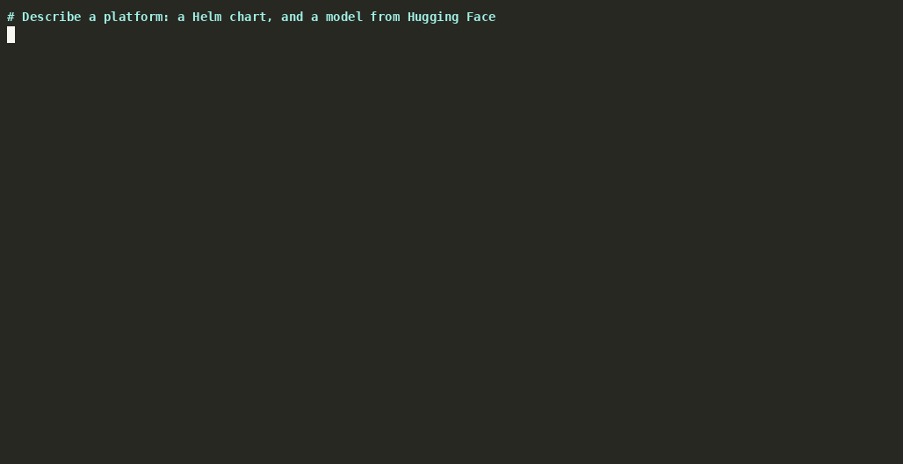
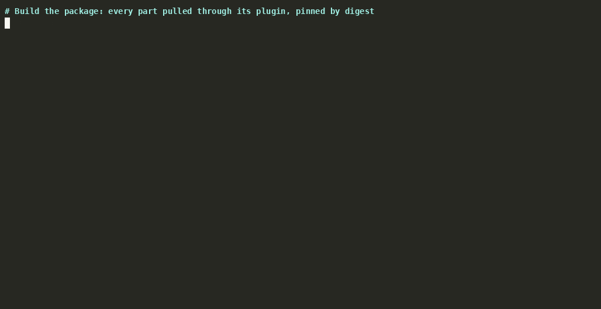
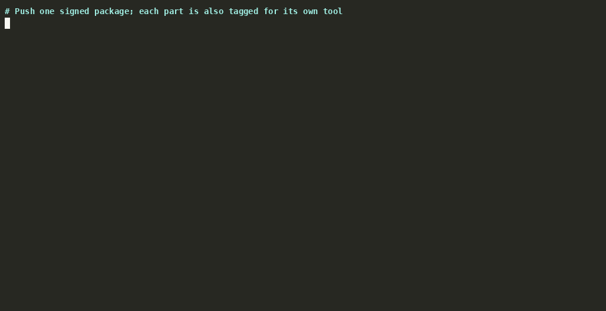
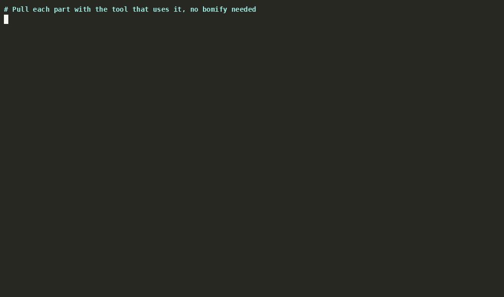

<h1 align="center">
  
</h1>

`bomify` packages an entire platform (container images, Helm charts,
models, and files) as one signed, scanned OCI artifact, and delivers it
through any registry or air gap to the tools that deploy it.

A platform is dozens of parts from different ecosystems, each with its
own registry and its own way of being trusted. bomify starts from a
[CycloneDX](https://cyclonedx.org/) SBOM listing them, the platform's
bill of materials. It pins every part by digest, and keeps the proof
with the package: signatures, vulnerability reports with VEX, and SLSA
provenance. Whoever receives it checks all of that before a byte is
written, and can still pull each part with its own tool.

**Assemble** one package from every medium:

- `bomify sbom compose` builds one SBOM from the mediums a platform
  spans, such as Helm charts and the images they run.
- `bomify build` pulls each component through a plugin for its type:
  OCI images and artifacts, Helm charts, Hugging Face models, and plain
  files.





**Trust** what you deploy:

- `--sign` and `--verify` (or `bomify trust` rules) sign whole packages
  and require trusted signatures, from one signer or several, before
  restoring them. Signatures are in cosign's format, so cosign and the
  admission controllers built on it verify them too.
- `bomify security scan` scans a package's components for
  vulnerabilities, can fail on a severity threshold with VEX exemptions,
  and can gate `pull`/`load` before anything is written. Publishers can
  attach VEX to a package (`push --vex`), which a verified pull honors.
- `bomify build --provenance` records SLSA build provenance, attached to
  the pushed package as a signed in-toto attestation, which `pull`/`load
  --verify-provenance` (or a `bomify trust --require-provenance` rule)
  can require.

**Move** it anywhere:

- `bomify push`/`pull` move a package through any OCI registry, as one
  OCI index holding each component in its own format (an image as
  itself, a chart as Helm stores one), which any registry tool can copy.
- `bomify save`/`load` carry it to air-gapped sites as a tarball, its
  signatures and reports included.



**Deploy** with the tools you already use:

- Push tags each component by name beside the package, so `docker
  pull`, `helm pull`, and `modctl` fetch it directly, and nothing where
  the platform runs needs bomify.



**[Docs site](https://alejandro-velasco.github.io/bomify/)**: installation,
a quickstart, how-tos, the CLI reference, and a guide to writing plugins.

## Status

**Pre-alpha.** Flags, the data directory layout, and the plugin
contracts may change without notice.

## Build

```sh
make build
```

## Usage

Install plugins. bomify only installs plugins something vouches for, so
the first time, install `sigstore` by digest and trust bomify's release
workflow (see [Installing plugins](plugins/README.md#installing-plugins)).
Then:

```sh
bomify plugin install oci
```

Build, tag, and publish a package:

```sh
bomify login registry.example.com
bomify build path/to/bom.cdx.json --tag registry.example.com/myapp:1.0
bomify push registry.example.com/myapp:1.0
bomify pull registry.example.com/myapp:1.0
```

Move it without a registry:

```sh
bomify save registry.example.com/myapp:1.0 -o myapp.tar
bomify load -i myapp.tar
```

Sign it, and require a trusted signature to pull it:

```sh
bomify push registry.example.com/myapp:1.0 --sign sigstore --sign-option key=cosign.key
bomify pull registry.example.com/myapp:1.0 --verify sigstore --verify-option key=cosign.pub
bomify trust create sigstore --match registry.example.com --option key=cosign.pub
```

Compose an SBOM for a Helm chart, build it, and scan it with grype:

```yaml
# bomify.yaml
name: postgresql
version: 18.11.6
sources:
  - name: postgresql
    medium: helm
    options:
      chart: postgresql
      repo: oci://registry-1.docker.io/bitnamicharts
      version: 18.11.6
```

```sh
bomify sbom compose bomify.yaml -o postgresql.cdx.json
bomify build postgresql.cdx.json --tag postgresql:18.11.6
bomify security scan grype postgresql:18.11.6 --fail-on high
```

Every command and flag is in [`docs/reference`](docs/reference).

## Container

[`Containerfile`](Containerfile) builds an image with `bomify` as the
entrypoint and the first-party plugins preinstalled in
`/tmp/.bomify/plugins`, built from your checkout (a release image
installs its release's signed plugin packages instead). It compiles
nothing: `make container-prebuilt` builds bomify and the plugins for it
first, statically (the Rust plugins on Linux, with `musl-tools`):

```sh
make container-prebuilt build-container
docker run --rm -v "$PWD/testdata/helm.cdx.json:/tmp/helm.cdx.json" \
  ghcr.io/alejandro-velasco/bomify:latest build -t registry.example.com/test:1.0.0 /tmp/helm.cdx.json
```

Mounting your own data directory over `/tmp/.bomify` replaces the
preinstalled plugins; install Linux builds into it from inside the
container (`... plugin install oci`).

## Testing locally

[`deploy/registry`](deploy/registry) runs a throwaway TLS-enabled OCI
registry for testing against.

## Plugins

bomify does no fetching, publishing, scanning, or signing itself; it
hands each to a `bomify-plugin-<kind>` binary in `~/.bomify/plugins`.
[`plugins/`](plugins) holds the first-party ones, and anyone can
[publish](plugins/README.md#publishing-a-plugin) their own against the
[component](plugins/contracts/component/v1/CONTRACT.md),
[SBOM generation](plugins/contracts/sbom/v1/CONTRACT.md),
[security scanning](plugins/contracts/security/v1/CONTRACT.md), or
[signing](plugins/contracts/signing/v1/CONTRACT.md) contracts. See
[`docs/architecture`](docs/architecture) for how it fits together.

## License

[Apache License 2.0](LICENSE).
