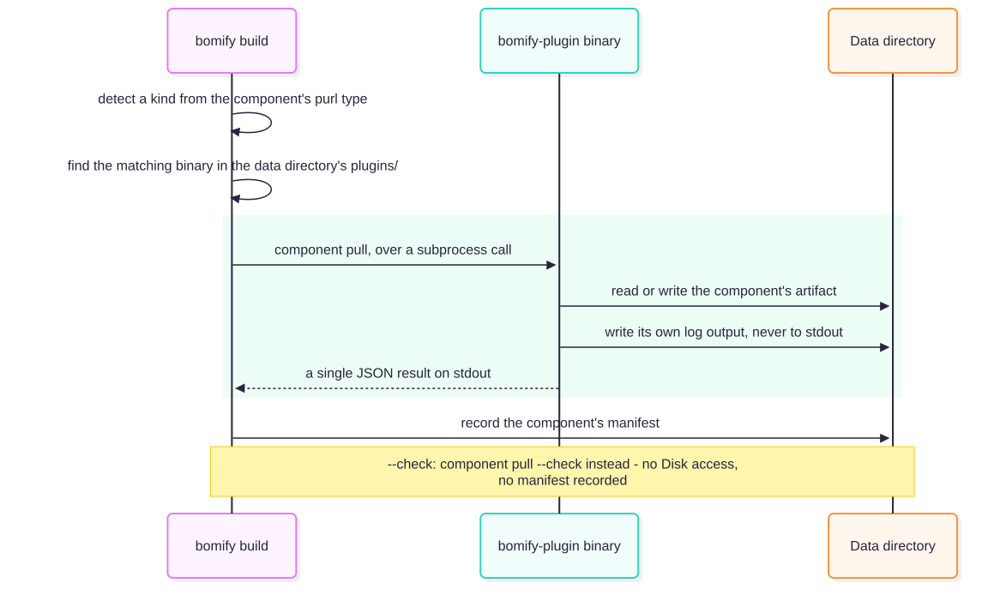

# Plugins

A plugin binary can implement any of five independent contracts:

| Contract | Subcommands | Used by | `<kind>` names |
| --- | --- | --- | --- |
| [Component](https://github.com/alejandro-velasco/bomify/blob/main/plugins/contracts/component/v1/CONTRACT.md) | `component pull/pack` | `build`, `push`/`save` | a purl type |
| [SBOM generation](https://github.com/alejandro-velasco/bomify/blob/main/plugins/contracts/sbom/v1/CONTRACT.md) | `sbom generate` | `sbom generate` | a deployment medium |
| [Security scanning](https://github.com/alejandro-velasco/bomify/blob/main/plugins/contracts/security/v1/CONTRACT.md) | `security scan/supported-components` | `security scan`, scan on pull | a scanner |
| [Signing](https://github.com/alejandro-velasco/bomify/blob/main/plugins/contracts/signing/v1/CONTRACT.md) | `signature sign/attest/verify/verify-attestation/supported-types` | `--sign`, `--verify` | a signing scheme |
| [Deployment](https://github.com/alejandro-velasco/bomify/blob/main/plugins/contracts/deployment/v1/CONTRACT.md) | `deployment generate` | `deploy generate` | a deployment medium |

Every call bomify makes to a plugin goes through `plugin.Invoke`: run
the binary, parse stdout as the contract's JSON result, and fold stderr
into the error on failure. `plugin.Find`, which locates the binary
first, refuses one that doesn't speak the contract version bomify needs
(see
[Plugin installation](plugin-installation.md#contract-versions)). On the plugin side, `pkg/plugin`'s
`ComponentCommand`, `SecurityCommand`, and `SignatureCommand` build each
contract's subcommands (flags, validation, logging, output) around a
small Go interface, so a first-party plugin's `cmd` package is only an
adapter over its `internal` logic. `NewRootCommand` adds the `contract`
subcommand every plugin answers with the version of each contract it
speaks (see
[contract versions](https://github.com/alejandro-velasco/bomify/blob/main/plugins/README.md#contract-versions)).

## Component plugins

For each SBOM component, `bomify build`:

1. **Detect** the kind from the purl type (`plugin.Detect`):
   `pkg:oci/...` is `oci`. A missing or unparseable purl fails.
2. **Find** `bomify-plugin-<kind>` in `plugins/`. The exception is
   `pkg:bomify-plugin/...`: a plugin binary itself, which `build` copies
   directly (see [Plugin installation](plugin-installation.md)).
3. **Delegate**: `component pull --purl --output`. The plugin prints one
   JSON `{outputPath, message, hash}`, where `hash` is the SHA-256 of
   what it pulled.

`bomify push` and `save` find each component's plugin the same way and
call `component pack --purl --input` on what `build` pulled,
for its kind's registry format, which goes in the package's index as it
is (see [Push and pull](registry.md)). A plugin binary component has no
plugin, and is packaged in bomify's own format. `pull` and `load` call no
component plugin.

stdout is reserved for the result and stderr for one fatal message.
Plugins log to `--log`, `logs/<purlHash>.log`, which bomify creates
fresh before each call, prints with its own log under `--verbose`
(prefixed `[<verb> <purl>]`), and deletes afterwards. `--log-color`
passes on whether bomify's log goes to a terminal.

`build` also passes `pull` a `--progress` file, `logs/<purlHash>.progress`,
created and deleted the same way. It tails it as the log, and shows each
part the plugin reports there as a bar of its own, alongside the bars
of OCI transfers (`cmd/multibar.go`), or a spinner until the plugin
reports one. Under the bars, bomify's log lines, the plugin's among
them, print above them (`logging.SetOutput`).

`build --check` passes `--check=true` instead of `--output`, asking the
plugin to cheaply confirm the pull would succeed. `plugin.CheckPull` is
stateless: no pid file, manifest, or layer directory, and `build
--check` records no build.

*Source: [`docs/diagrams/plugin-dispatch.mmd`](https://github.com/alejandro-velasco/bomify/blob/main/docs/diagrams/plugin-dispatch.mmd)*

## SBOM generation

A plugin's `sbom generate` takes its options as a `--config` file, which
it validates itself. Its SBOM is the part of a CycloneDX BOM bomify reads
(metadata, components, dependencies), following rules strict enough to
merge several plugins' SBOMs into one: every component identified by its
purl, nothing nested, no timestamp. `pkg/plugin`'s `SBOMCommand`
implements both sides for a Go plugin, and its `ValidateGenerated`
checks the rules; cyclonedx-go itself checks the CycloneDX objects, as
bomify decodes them rejecting unknown fields.

`bomify sbom compose` is its caller
([`internal/sbom`](https://github.com/alejandro-velasco/bomify/tree/main/internal/sbom)'s
`Composition`). It finds every source's plugin before running any,
reads each SBOM strictly (`sbom.DecodeStrict`), then merges them:
components by purl
(sources disagreeing on one's type, name, version, or hashes fail),
dependencies unioned, and the composition as the root, depending on
each source's root. Everything is sorted and the spec version pinned,
so an unchanged composition yields the same SBOM, and `bomify build`
the same package.

## Deployment

`bomify deploy generate` is the caller
([`internal/deploy`](https://github.com/alejandro-velasco/bomify/tree/main/internal/deploy)).
It reads a package from the registry it'll be deployed from, verified
as pull verifies it (`pull.FetchVerified`), with no component
downloaded, and describes it to each plugin (`deploy.Describe`): every
component pinned by digest in the package's repository, and its tag
only once the registry confirms the tag points at it. Its deployments are
the package's own, fetched from its deployments manifest
(`deploy.LoadPackaged`, which refuses a template path outside them), with
`--file` laid over them by name (`deploy.Lay`); `bomify deploy list`
reads them the same way, and prints them. It finds every
deployment's plugin before running any, runs each into its own
directory of a staging directory, checks each wrote exactly the regular
files it reports, and moves the lot into `--output` only once all have
succeeded (`pull.WriteInto`). Each plugin logs to
`logs/deployment-<name>.log`, as a component plugin logs.

## Concurrent, idempotent pulls

`plugin.Pull` is safe to call concurrently, even across processes, for
components sharing a purl hash:

- `manifests/<purlHash>.pid` holds the PID of the process pulling it. A
  second caller waits until the file is gone or its process is dead.
- A stale pid file (process gone) is discarded and the pull redone.
- If a manifest exists and nothing is pulling, the result is reused. A
  reused or fresh result is always checked against the SBOM's declared
  hash, so a same-purl component with a different hash never slips
  through.
