# Registry format

What bomify writes to an OCI registry, or to a `bomify save` tarball (an
OCI image layout), is what other tools, and older and newer bomify
releases, have to read. From bomify's last alpha release on, this format
is a public interface: it changes only as [Versioning](#versioning)
describes. [Push and pull](registry.md) covers how bomify reads and
writes it.

Everything below is OCI 1.1: an image index, and image manifests. bomify's
own types and annotations are named `application/vnd.bomify.*` and
`land.bomify.*`.

## Package

The package is the one image index a tag points at: the SBOM's manifest,
first, then each component's own manifest, all in that one repository.
So any tool that copies an index (`oras cp`, `crane copy`, registry
replication) copies the whole package, each blob stored once, and each
component can be fetched from the package's repository by its digest.
Every other artifact is a referrer of the index, so none changes its
digest.



*Source: [`docs/diagrams/registry-layout.mmd`](https://github.com/alejandro-velasco/bomify/blob/main/docs/diagrams/registry-layout.mmd)*

| Part | Type | Holds |
| --- | --- | --- |
| Index | artifact type `application/vnd.bomify.package.v1+json` | The SBOM manifest, then each component's manifest, once each, in the SBOM's order. Annotated `org.opencontainers.image.created` with the SBOM's `metadata.timestamp` in UTC (RFC 3339), or the Unix epoch without one, so pushing an unchanged package gives the same digest. |
| SBOM manifest | artifact type `application/vnd.bomify.sbom.v1+json`, on the manifest and its index entry | Config: the package's CycloneDX SBOM (`application/vnd.cyclonedx+json` or `+xml`), as `bomify build` assembled it. Layers: the [files map](#files-map), then the [extra files](#files-map) it names. |
| Component manifests | their own | One per component, its index entry annotated `land.bomify.purl` and carrying its artifact type, if any. In the component's own registry format where its plugin has one (see [`component pack`](https://github.com/alejandro-velasco/bomify/blob/main/plugins/contracts/component/v1/CONTRACT.md#component-pack)), such as an image or a Helm chart, as it is; a model as [ModelPack](#modelpack); anything else in [bomify's format](#bomifys-component-format). |

No manifest bomify builds is annotated with the time it was built, so an
unchanged component gives the same manifest in every package.

### bomify's component format

A component with no registry format of its own is a manifest of
artifact type `application/vnd.bomify.component.v1+json`, with an empty
config (`application/vnd.oci.empty.v1+json`) and one layer per file,
by path: `application/vnd.bomify.component.file.v1`, the file's own
bytes, annotated `land.bomify.purl` and `org.opencontainers.image.title`
with its path in the component, so `oras pull` writes the component out
as `build` pulled it. A file is never split, so one past a registry's
layer limit (10 GB on GHCR and Docker Hub) can't be pushed there. A
component with no files has the empty descriptor as its one layer, as
OCI suggests for an artifact without any.

### ModelPack

A `machine-learning-model` component whose plugin packs nothing is a
[ModelPack](https://github.com/modelpack/model-spec) artifact, which
ModelPack's own tools and `oras pull` pull: artifact type
`application/vnd.cncf.model.manifest.v1+json`, a config of the
component's name and version and its layers' digests, and one raw layer
per file, by path, annotated `org.cncf.model.filepath` and
`org.opencontainers.image.title` with its path. A file of
64 MiB or more is `application/vnd.cncf.model.weight.v1.raw`, any other
`application/vnd.cncf.model.weight.config.v1.raw`, both annotated
`org.cncf.model.file.mediatype.untested`, since nothing checks what a
file holds. A model with no files is in bomify's format instead.

### Files map

The SBOM manifest's first layer, `application/vnd.bomify.files.v1+json`,
is what pull restores every component from, file by file:

```json
{
  "components": [
    {
      "purl": "pkg:oci/nginx@1.27",
      "files": [
        { "path": "blobs/sha256/<hex>", "mode": "0644", "mediaType": "application/vnd.oci.image.manifest.v1+json", "digest": "sha256:<hex>", "size": 1234 },
        { "path": "index.json", "mode": "0644", "mediaType": "application/vnd.bomify.component.file.v1", "digest": "sha256:<hex>", "size": 245 }
      ]
    }
  ]
}
```

Each file names the blob holding exactly its bytes, by path in the
component's directory and permission bits: a layer of the component's
own manifest in bomify's format or ModelPack, one of its artifact's
blobs where it is one (an image's layer, in the OCI image layout it was
pulled as), and otherwise an extra file, a `application/vnd.bomify.component.file.v1`
layer of the SBOM manifest annotated `land.bomify.purl`, after the files
map, in the components' order and by path.

A component's files are all regular files: push refuses a symlink or
anything else no blob holds. Pull refuses a map that names a component
or a path twice, a path outside its component, a mode beyond permission
bits, or a digest that isn't SHA-256, before restoring anything, and
restores a component only once every one of its files verifies.

## Component repositories

Unless `push --skip-component-repositories`, each component's manifest
is also tagged in a repository of its own beside the package's, where
its own tools pull it by name: `docker pull`, `helm pull --version`,
`oras pull`. It's the very manifest the index holds, its blobs mounted
from the package's repository, so a registry stores each once. Copying
the index doesn't copy these tags; the index still names each (see
below), and a component can always be pulled by digest from the
package's repository.

```
registry.example.com/team/app:1.0                    the package's index
registry.example.com/team/app/oci/nginx:1.27         pkg:oci/nginx@1.27?repository_url=...
registry.example.com/team/app/helm/podinfo:6.7.1     pkg:helm/podinfo@6.7.1?repository_url=...
registry.example.com/team/app/huggingface/org/model:<commit>
registry.example.com/team/app/generic/tool:1.0
```

- **Repository:** the package's, then one segment for each of the
  purl's type, namespace segments, and name, each lowercased, with any
  run of characters a repository name can't hold as `-`.
- **Tag:** the purl's version, `+` written as `_`, as Helm does, or
  `latest` without one. An image's is its `tag` qualifier, if it has
  one; an image pinned to a digest without one is pushed untagged, by
  digest. Other qualifiers and a subpath are left out.
- **Platforms:** components that differ only in their `os` and `arch`
  qualifiers share a tag, as an index of each platform's manifest.
  Components that would share a tag otherwise, with different content,
  are refused when tagging; without it, the index names only the first.
  A push without component repositories, or a save, never fails on one.
- **Signing:** with `--sign`, each is signed where it's tagged, before
  the package's tag moves.

Each component's index entry names where it's tagged in
`land.bomify.component.reference`, relative to the package's repository
(`helm/podinfo:6.7.1`, or `oci/nginx@sha256:...` untagged), whether or
not push tags it, so the index is the same wherever the package is
pushed or saved. A pull or a load keeps no record of it: the next push
works it out from the purl again.

## Referrers

Each referrer's `subject` is the package's index. Those bomify builds
itself have an empty config (`application/vnd.oci.empty.v1+json`) and
an `org.opencontainers.image.created` annotation.

| Referrer | Artifact type | Layers | Pushed by |
| --- | --- | --- | --- |
| Vulnerability reports | `application/vnd.bomify.vulnerabilities.v1+json` | One `application/vnd.bomify.component.vulnerabilities.v1+json` per scanner per component: the CycloneDX report that scanner wrote. | `push`/`save`, from the local reports |
| VEX | `application/vnd.bomify.vex.v1+json` | Exactly one `application/vnd.bomify.vex.document.v1`: an OpenVEX, CSAF, or CycloneDX VEX document, told apart by content. One referrer per document. | `push`/`save --vex`, signed like the package |
| Signature | the signing plugin's (e.g. `application/vnd.dev.sigstore.bundle.v0.3+json`) | One: the plugin's envelope, of its media type. | `push`/`save --sign` |
| Provenance, signed | the signing plugin's | One: the plugin's DSSE envelope of the in-toto statement. | `push`/`save` of a package built with `--provenance`, when signing |
| Provenance, unsigned | `application/vnd.in-toto+json` | One `application/vnd.in-toto+json`: the in-toto statement. | the same, without signing |

A signed referrer takes the signing plugin's artifact and media types,
its ecosystem's standard ones, so that ecosystem's own tools (e.g.
`cosign`) find it; see the signing contract's
[`artifactType`](https://github.com/alejandro-velasco/bomify/blob/main/plugins/contracts/signing/v1/CONTRACT.md).
bomify tells a provenance attestation apart by its
`land.bomify.attestation.predicateType` annotation instead.

The vulnerability reports referrer's `created` is its newest report's
time. A re-scan pushes a new one rather than changing the package, and a
pull restores only the newest.

## Annotations

| Annotation | On | Value |
| --- | --- | --- |
| `land.bomify.purl` | component index entries, layers of bomify's component format, extra files, report layers | The component's purl. |
| `land.bomify.component.reference` | component index entries | Where the component is tagged beside the package, relative to its repository (see [Component repositories](#component-repositories)). |
| `land.bomify.scan.plugin` | report layers, the reports referrer | On a layer, the scanner whose report it is; a pull restores it under that name. On the referrer, every scanner it carries reports of, sorted, comma-separated, informational only. |
| `land.bomify.signature.plugin` | signature and signed attestation referrers | The kind of signing plugin that made it. Informational. |
| `land.bomify.attestation.predicateType` | provenance referrers | The in-toto predicate type, `https://slsa.dev/provenance/v1`. Marks the referrer as an attestation, which signature verification skips. |
| `land.bomify.provenance.statement` | provenance referrers | The SHA-256 of the statement, so pushing the same provenance again attaches nothing new. |
| `org.opencontainers.image.created` | the package's index and bomify's referrers | See above; orders referrers, newest first. |
| `org.opencontainers.image.title` | layers of bomify's component format and ModelPack's, report layers, VEX layers | A filename, for `oras pull` to write the layer to: a file's path in its component, or for a report its path under the data directory's `vulnerabilities/` (`<purl hash>/<scanner>.json`), so `oras pull` lays reports out as bomify keeps them. |

A signing plugin may add annotations of its own to its referrers.

## Plugin packages

A package `bomify plugin install` installs from is an ordinary package
whose SBOM describes each binary as a `pkg:bomify-plugin/<kind>@<version>`
component, with `os` and `arch` qualifiers in Go's `GOOS`/`GOARCH` terms.
Its `land.bomify.plugin.contracts` property holds the contract versions
the binary speaks, as its `contract` command prints them (e.g.
`{"component":1}`). See [Plugin installation](plugin-installation.md).

## Finding referrers

bomify lists a package's referrers with the registry's Referrers API.
Where the registry lacks it (e.g. ghcr.io), it falls back to the OCI
referrers tag schema: an index tagged `sha256-<package digest>` that
lists them, rewritten on every push of a referrer. bomify leaves the
superseded index untagged for the registry to collect, rather than
deleting it, since many such registries refuse deletes.

Either way, bomify filters by artifact type itself, since some registries
ignore the filter, and orders by `org.opencontainers.image.created`.
Referrers are untrusted: bomify reads at most 4 MiB of a referrer
manifest, VEX document, or signature envelope.

## Versioning

Each bomify media and artifact type carries a version (`v1`). A change
that a reader of the current version would misread, such as removing or
renaming an annotation or changing what a blob holds, gets a new version
(`v2`). Adding an optional annotation doesn't.

What this bomify does with a type it doesn't know:

- **Package:** pull refuses a tag that isn't an index of the package's
  artifact type with exactly one SBOM manifest, and ignores index
  entries that are neither the SBOM manifest nor annotated with a purl.
- **Component manifest** the files map doesn't lay out: refused, as pull
  can't restore it. Pull never reads a component's manifest, so its
  format doesn't matter to pull.
- **Files map** fields it doesn't know: ignored.
- **Reports and VEX referrers** of another artifact type, and their
  layers of another media type: ignored. A VEX referrer without exactly
  one VEX layer is skipped with a warning.
- **Signatures:** only referrers of an artifact type the signing plugin
  lists in `signature supported-types` are verified.
