# Push and pull

[`internal/oci/push`](https://github.com/alejandro-velasco/bomify/tree/main/internal/oci/push) and
[`internal/oci/pull`](https://github.com/alejandro-velasco/bomify/tree/main/internal/oci/pull) store a package as an OCI
image index of the SBOM's manifest and each component's own, all in the
tag's repository (every type and annotation is listed in
[Registry format](registry-format.md)):

*Source: [`docs/diagrams/oci-artifact.mmd`](https://github.com/alejandro-velasco/bomify/blob/main/docs/diagrams/oci-artifact.mmd)*

`push` plans each component first (`push.planComponent`), asking its
plugin's `component pack` (`transfer.Options.Pack`, which `cmd` points at
`plugin.Pack`) for its kind's registry format, so pushing needs each
component's plugin installed; a plugin binary component has none, and
is packaged in bomify's format. A pack's artifact goes in as it is: its
blobs from the files in the component's directory that hold them, then
its manifests, and the blobs the plugin built, inline, with
`oras.CopyGraph`. Every file of the component's directory that isn't
one of those blobs is an extra file, a blob of its own, and the files
map records which blob holds each file. A model the plugin doesn't pack
is ModelPack, and anything else bomify's format, both a layer per file
(`push.fileBlobs`), titled with its path for `oras pull`, so an
unchanged file is the same blob in every package, and uploads once. A
file is never split, as ModelPack's and KitOps' aren't; one past a
registry's layer limit can't be pushed there. Every component's files
must be regular files (`push.listFiles`): a blob holds no symlink.

Every component's blobs then upload together, concurrently
(`--concurrency`), each verified against its digest and size as it
streams, with a progress bar per blob, before any manifest that names
them: each component's, then the SBOM manifest, then the index. `push`
skips blobs the target already has. That's required, not an
optimization: a local `content/oci.Store` rejects re-pushing a digest,
which `save` hits when tags share a component. A file streams straight
from disk, read once to hash and once to upload, so it's never copied.
bomify builds its manifests itself
rather than with `oras.PackManifest`, which stamps each with the time,
so pushing an unchanged package gives the same digest.

**Signatures**, the **report referrer**, **VEX referrers**, and the
**provenance attestation** (see [Build provenance](provenance.md)) are
OCI referrers of the index, so none changes the package digest.

*Source: [`docs/diagrams/registry-signatures.mmd`](https://github.com/alejandro-velasco/bomify/blob/main/docs/diagrams/registry-signatures.mmd)*

With `transfer.Options.ComponentTarget` set, as `bomify push` sets it
unless `--skip-component-repositories`, push then tags each component
in a repository of its own beside the package's (see
[Component repositories](registry-format.md#component-repositories)),
after the package's referrers and before its tag moves. `push.planSites`
names each site from the component's purl, before the index is pushed,
and the index records each site relative to the package, whether or not
push tags. A component it can't place, such as one colliding with
another, fails a push that tags before anything is tagged, and is just
left unnamed otherwise, so `save` and `--skip-component-repositories`
never fail on one. `push.componentTagger` copies each manifest from the
package's repository with `oras.CopyGraph`, mounting every blob
(`transfer.MountBlob`) and pushing only manifests, so it needs nothing
but the package as pushed. A registry that won't mount gets an upload
instead.

`pull` reads the index (`transfer.FetchPackage`), its SBOM, and the files
map, then restores each component, up to `--concurrency` at once, into a
temporary directory it swaps into place only once every file verifies
(see `pull.componentRestore`), file by file, as the files map lays out.
`transfer.FetchFiles` checks every path and mode before anything
downloads, and each file is written through an `os.Root`, refusing one
that exists. No more than `--concurrency` blobs download at once across
all the components. Pull needs no component plugin.

## Save and load

`bomify save`/`load` ([`internal/oci/save`](https://github.com/alejandro-velasco/bomify/tree/main/internal/oci/save)) run
`push`/`pull` unchanged against a local OCI image layout instead of a
registry, then tar or untar it. Shared components are stored once, and
signatures and report referrers travel inside the tarball, so `load`
verifies and restores exactly as `pull` does.

*Source: [`docs/diagrams/save-load.mmd`](https://github.com/alejandro-velasco/bomify/blob/main/docs/diagrams/save-load.mmd)*

## Credentials

[`internal/auth`](https://github.com/alejandro-velasco/bomify/tree/main/internal/auth) is the one source of registry
credentials, for `login`/`logout`, `push`/`pull`, and plugins through
[`pkg/auth`](https://github.com/alejandro-velasco/bomify/tree/main/pkg/auth). `login`/`logout` write only
`<dataDir>/conf/auth.json`, a Docker-format config backed by the native
credential store as Docker's is. Reads try it first, then Docker's own
`config.json`, so an existing `docker login` still works and `bomify
logout` never removes it. Native helpers key secrets by host alone, so
both tools share one secret for a host logged into with both.

`Login` verifies a credential before storing it, and falls back to
plaintext in `auth.json` (with a warning) only when no credential helper
exists, as `docker login` does. `login --verify=false` (`Save`) stores
one unverified instead, the same way, for a host that isn't an OCI
registry and so can't be checked: a Hugging Face hub
`bomify-plugin-huggingface` pulls from, or an HTTPS server
`bomify-plugin-generic` downloads from. bomify exports the data
directory in use as `BOMIFY_DATA_DIR` to the plugins it runs, so
`pkg/auth` finds the same `auth.json` under `--data-dir`.
