# Signing and verification

A package is signed as a whole: the signature covers its OCI index,
which pins the SBOM and every component by digest, and `pull` verifies each
blob against those digests. The report referrer and VEX referrers are
signed and verified the same way, separately. Signatures never go in the SBOM, whose hash is
the build's identity.

[`internal/signature`](https://github.com/alejandro-velasco/bomify/tree/main/internal/signature) implements
`transfer.Options.Sign` and `Verify`, so `save`/`load` get both for free.

- **Sign** (`push`/`save --sign <kind>`, `--signer <name>`): after
  packing and before tagging, bomify writes the payload (the index's
  `mediaType`, `digest`, and `size` as JSON), runs the plugin's
  `signature sign`, and pushes the envelope as an OCI 1.1 referrer of
  the plugin's artifact type. `--signer` (repeatable) names a stored
  signer (`conf/signers.json`, from `bomify signer create`): a plugin
  and its options. `signature.NewSigners` signs the index and every other referrer
  the push attaches with each in turn, so a co-signed package's reports
  and VEX carry every signature too. A failed sign never leaves a tag on
  an unsigned package. The
  payload omits `artifactType`, which registries don't return when
  resolving a tag, so it's identical at pull time. On registries without
  the Referrers API (ghcr.io), bomify sets `SkipReferrersGC`, so the
  superseded tag-schema index is left untagged rather than deleted,
  which those registries refuse.
- **Sign later** (`bomify sign <reference>`, or `--input <tarball>`):
  `internal/oci/sign` resolves the reference, checks it's a
  bomify package's index, and signs it with the same signer push uses,
  fetching only manifests. Its vulnerability report and VEX referrers
  are signed only if `--referrer` names them by digest, all checked
  before anything is signed: anyone who can push can attach one, and a
  signed VEX document exempts findings. The rest are logged as unsigned.
  Each signature is one more referrer, so co-signers can
  sign at different times, in different environments. A tarball is
  extracted, every tag signed, and re-archived. Provenance isn't
  attested again: one trusted attestation is enough.
- **Verify** (`pull`/`load`): before fetching anything,
  `signature.Policy` picks the signers the reference must satisfy:
  `--verify` (one, with only its own `--verify-option`s), else the most
  specific `conf/trust.json` rule's, else none. `load` refuses a tag
  that no rule matches once any rule exists (`Policy.UntrustedNames`),
  since a tarball names its own tags. `--insecure-skip-verify`
  overrides a rule, with a warning. Key options are resolved to
  `option=<stored copy path>` as rules are read
  (`signature.ReadResolved`), which also refuses a rule that doesn't
  validate, such as one with no signers. For each signer
  (`signature.VerifySigners`), bomify lists the index's
  referrers, keeps those whose artifact type its plugin's `signature
  supported-types` lists, and asks `signature verify`, with that
  signer's options, about each until one passes. The pull goes ahead
  once the rule's `require` signers have passed (every signer when it's
  unset), and otherwise fails with nothing written, naming each signer
  that didn't. Everything afterwards is fetched by that verified
  descriptor.
- **Verify provenance** (`--verify-provenance`, or a rule's
  `--require-provenance`): the same signers then verify the package's
  build provenance attestation, one of them sufficing; see
  [Build provenance](provenance.md#verifying).

Since each signer is checked with its own options, one envelope counts
for two signers only if both trust whoever made it.

*Source: [`docs/diagrams/signing.mmd`](https://github.com/alejandro-velasco/bomify/blob/main/docs/diagrams/signing.mmd)*

*Source: [`docs/diagrams/verification.mmd`](https://github.com/alejandro-velasco/bomify/blob/main/docs/diagrams/verification.mmd)*

Plugins never talk to a registry; bomify moves every envelope itself,
which is why one plugin works for registries and tarballs alike.

What verification guarantees, and what it doesn't, is in
[Trust model](trust-model.md).

## Rule files

Both files are JSON arrays, covered by the
[data directory version](data-directory.md#versioning) and read
strictly: an unknown field fails the command rather than being ignored,
so a misspelling can't drop a requirement.

### `conf/trust.json`

One rule per `match`, written by `bomify trust create`; the most
specific `match` applies.

A `match` and a repository are compared
case-insensitively, after canonicalizing a leading registry host: a
trailing `.` and port `443` are dropped, and `index.docker.io` and
`registry-1.docker.io` read as `docker.io`. So no other spelling of a
registry escapes its rule.

| Field | Type | Meaning |
| --- | --- | --- |
| `match` | string | `/`-separated prefix of a package's repository, matched at segment boundaries, e.g. `registry.example.com/team`. Omitted or empty matches every package. |
| `signers` | array | At least one signer, below. |
| `require` | integer | How many of `signers` must verify. Omitted or `0` means all of them. |
| `provenance` | boolean | Also require build provenance attested by one of `signers` (see [Build provenance](provenance.md#verifying)). |

Each signer:

| Field | Type | Meaning |
| --- | --- | --- |
| `name` | string | Tells a rule's signers apart. At most one per rule may omit it, as `trust create` does without `--signer`. |
| `plugin` | string | The signing plugin, `bomify-plugin-<plugin>`, that verifies this signer's signature. |
| `options` | array of strings | `key=value` options passed unparsed to the plugin's `signature verify`. |
| `keyOptions` | object | Plugin option name to the name of a key in `keys/`, passed as `<option>=<path of the stored copy>`. An option can't also appear in `options`. A key can't be removed while a rule names it. |

### `conf/signers.json`

One entry per `name`, written by `bomify signer create`, for `push`,
`save`, and `sign --signer`.

| Field | Type | Meaning |
| --- | --- | --- |
| `name` | string | The name `--signer` takes. |
| `plugin` | string | The signing plugin, `bomify-plugin-<plugin>`. |
| `options` | array of strings | `key=value` options passed unparsed to its `signature sign` and `signature attest`, such as a private key's path. Never key material. |
