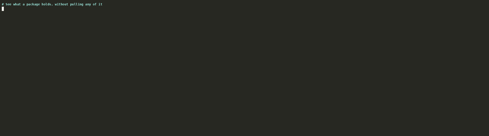

# Pulling one component into a directory

`bomify component pull` downloads just one component of a pushed package
into a plain directory, verified like a whole package. For a model,
that's the directory a server loads it from. Nothing is written to the
data directory, so it suits a short-lived container, such as an init
container filling a volume.



## 1. See what the package holds

```sh
bomify component list registry.example.com/team/llm-serving:1.0.0
```

This prints each component's name, type, size, and purl. It also shows
the reference `push` tagged it under, for pulling it with docker, helm,
or oras instead (see
[Publishing and pulling packages](publishing-and-pulling-packages.md)).
Only the package's index, SBOM, and file list are read.

## 2. Pull one component

Name the component by its name, by `<name>@<version>`, or, when several
share a name, by its purl:

```sh
bomify component pull registry.example.com/team/llm-serving:1.0.0 SmolLM2-135M --output models/smollm2
bomify component pull registry.example.com/team/llm-serving:1.0.0 \
  'pkg:oci/vllm-openai@v0.32.0?repository_url=index.docker.io%2Fvllm%2Fvllm-openai' --output vllm-openai
```

Each component's files come out as they were when the package was built.
A model's files are as they are on the Hub, and an image is an OCI image
layout.

`--output` must be missing or empty, as a freshly mounted volume is. If
the pull fails, the directory is left as it was.

## 3. Verify it

`--verify` and `bomify trust` rules work as they do for `bomify pull`.
The package is verified before anything is downloaded:

```sh
bomify component pull registry.example.com/team/llm-serving:1.0.0 SmolLM2-135M --output models/smollm2 \
  --verify sigstore --verify-option key=cosign.pub
```

See [Signing and verifying packages](signing-and-verifying-packages.md).

## 4. Update a directory in place

`--replace` pulls into a directory that already holds files, such as an
earlier version. The old files are removed only once every new one has
downloaded and verified, so a failed update keeps them:

```sh
bomify component pull registry.example.com/team/llm-serving:1.1.0 SmolLM2-135M --output models/smollm2 --replace
```

## In a container

The [container image](../getting-started/installation.md#container-image)
has the sigstore plugin preinstalled, so it can verify too. Mount the
volume at `--output`, and the registry's credentials as Docker's
`config.json`, which bomify reads when it has none of its own.
